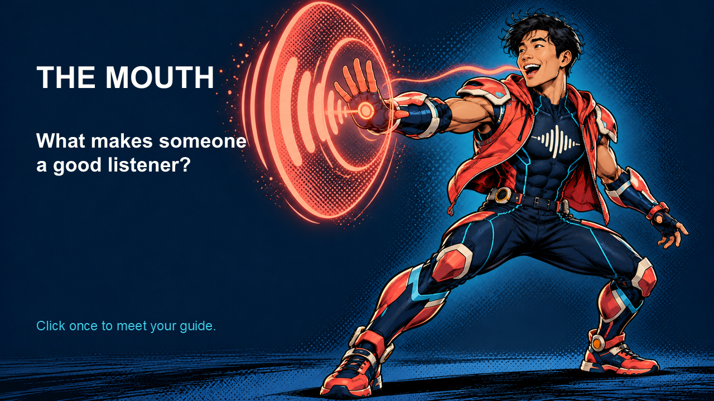
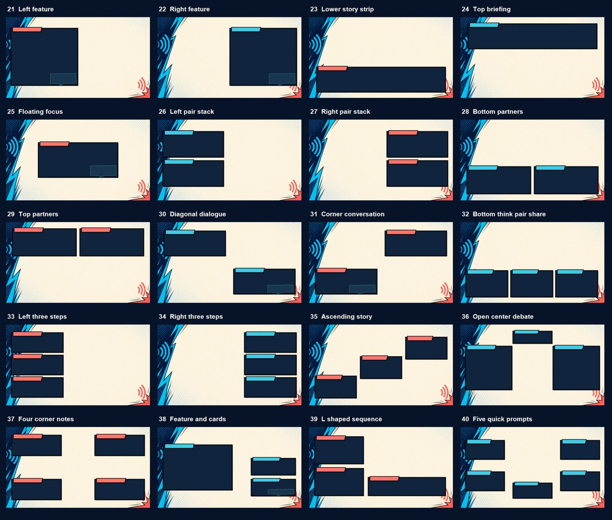

# Comic PPTs



An AI skill for making editable Speaking and Listening PowerPoint lessons in a superhero comic style, starring **The Mouth** (speaking) and **The Ear** (listening). It bundles 20 comic backgrounds, 20 dark-on-light and 40 white comic pane layouts, header tabs and footer answer boxes, hero candidates, a supporting cast and a reference deck with click reveals.



## Install

**Download:** [comic-ppts.zip](https://github.com/leckwallnut/comic-ppts-coworker-kit/releases/latest/download/comic-ppts.zip) from the [latest release](https://github.com/leckwallnut/comic-ppts-coworker-kit/releases/latest). Unzip it. You get one folder, `comic-ppts`, with `SKILL.md` at its root.

Copy that whole folder into your assistant's personal skills folder, keeping its name and everything inside it:

| Assistant | Personal skills folder |
| --- | --- |
| Claude Code | `~/.claude/skills/` (on Windows, `C:\Users\<your-name>\.claude\skills\`) |
| Codex | `~/.codex/skills/` (on Windows, `C:\Users\<your-name>\.codex\skills\`) |
| Other assistants that support [Agent Skills](https://agentskills.io) | See that assistant's documentation for its skills folder |

Afterwards `SKILL.md` must sit directly inside `comic-ppts`. Start a new chat or restart the assistant, then ask: "Which skills can you use?" The list should include `comic-ppts`.

You can also ask your assistant to install it for you:

```text
Please install the Comic PPTs skill from https://github.com/leckwallnut/comic-ppts-coworker-kit

The skill is the folder comic-ppts in that repository. Copy that whole folder, keeping its name and everything inside it, into your personal skills folder so I can use it in every project. Do not change any files. Then tell me where you put it, and check that you can see a skill named comic-ppts.
```

## Use it

Ask for the skill by name, in whatever form your assistant uses: `/comic-ppts` in Claude Code, `$comic-ppts` in Codex, or plain words ("Use the Comic PPTs skill") anywhere else. For example:

```text
Use the Comic PPTs skill (comic-ppts) to create a 12-slide Speaking and Listening lesson on asking follow-up questions. Put stage titles in header tabs and model answers in footer boxes. Include click-to-reveal answers where supported. Keep text editable and check every slide.
```

If your assistant has no skills feature, open the unzipped folder as its working folder and paste `Read ./comic-ppts/SKILL.md and use that skill for this task.` before your request.

## What is inside

| Resource | Where |
| --- | --- |
| The skill | [SKILL.md](comic-ppts/SKILL.md) |
| Design rules, motion and workflow | [references](comic-ppts/references) |
| Backgrounds, panes, tabs and characters | [assets/library](comic-ppts/assets/library) |
| 3-slide reference deck and preview | [reference.pptx](comic-ppts/assets/reference.pptx), [preview.png](comic-ppts/assets/preview.png) |
| Windows PowerPoint motion helper | [apply-powerpoint-motion.ps1](comic-ppts/scripts/apply-powerpoint-motion.ps1) |
| What was compressed | [distribution-notes.md](comic-ppts/references/distribution-notes.md) |

## Good to know

- The skill is assistant-neutral: it is a standard `SKILL.md` folder, and the instructions name no particular tool. It has not been tested in other assistants yet.
- Building the PowerPoint needs an authoring tool (a presentation tool, python-pptx or pptxgenjs). The motion helper needs Windows, desktop PowerPoint and PowerShell.
- This is a compressed copy (about 25 MB). Opaque pictures are JPEG; transparent panes, tabs and components are unchanged.
- The artwork is AI-generated illustration. The Ear's design and the final Mouth appearance are not yet approved; the library holds candidates.
- Motion cannot be proven by still images. Click through the finished file in Slide Show before class.

## License

[CC BY-NC 4.0](LICENSE): free to share and adapt with credit, not for commercial use.
